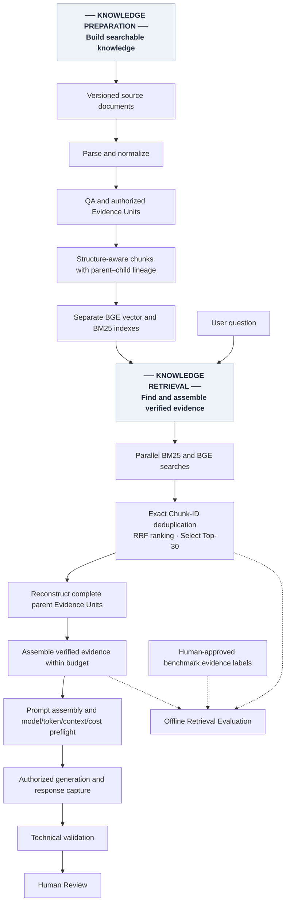

# RAG Intelligence Hub
### Building and evaluating an evidence-grounded AI knowledge assistant

**Week 2 Project Submission · Mastering Agentic AI · November 2026**  
**Use case:** Bring your own · **Build track:** Code-based Python · **Application:** Streamlit  
**Status:** Review draft; not submitted.

## 1. Project overview: the problem and my solution

Learning RAG involves more than understanding embeddings, chunking and vector databases. A learner must also understand whether an answer is supported by the right documentation, whether important qualifications were preserved, and why a system may fail despite finding a relevant passage.

I built **RAG Intelligence Hub** to help AI learners and developers ask questions about RAG fundamentals, implementation approaches and architectural trade-offs using original research and official technical documentation.

The application provides source-linked answers and makes the preparation, retrieval, evidence assembly and evaluation stages inspectable. Its value is both answering questions and explaining why an answer succeeded, remained incomplete or required review.

A representative question is:

> In the original RAG paper abstract, what are the parametric and non-parametric memory components of the model?

An effective answer should identify the correct concepts, cite the original paper and disclose applicable evidence limitations.

**Project one-liner:** My RAG app helps AI learners and builders answer RAG questions from 16 curated research papers and technical documents through Streamlit, targeting **at least 95% claim-level faithfulness**.

That percentage is a **project-defined target, not an achieved result**. Faithfulness requires claims to be supported by the evidence supplied to the model; fluent language and valid citation IDs alone do not establish it.

## 2. Corpus, technology and design choices

| Layer | Implemented choice | Reason |
|---|---|---|
| Corpus | 16 versioned sources: four PDFs, one Markdown document and eleven HTML sources | Ground answers in original research and official documentation |
| Preparation | Format-aware parsing, structural normalization and source QA | Preserve document structure, provenance and content restrictions |
| Chunking | Structure-aware parent–child chunks; default 384 BGE tokens, four approved exceptions up to 512, zero added overlap | Make evidence searchable while retaining its complete parent context |
| Embeddings | Local `BAAI/bge-small-en-v1.5`, producing 384-dimensional vectors | Support semantic retrieval locally |
| Indexing and retrieval | Separate BM25 lexical index and BGE vector index in Chroma; Reciprocal Rank Fusion | Combine keyword and semantic search without treating their raw scores as interchangeable |
| Generation | OpenAI adapter, recorded model identifier `gpt-6-luna`, versioned prompt and response schema | Produce evidence-linked answers with explicit missing-information disclosures |
| Interface and verification | Streamlit, pytest, Ruff, AppTest and selected browser checks | Inspect execution and test bounded changes |

The implementation uses **Python 3.12.15**, Pydantic, PyMuPDF, markdown-it-py, dedicated HTML ingestion, LangChain text splitters, Sentence Transformers and isolated `uv` environments. LangGraph was unnecessary for the deterministic workflow.

The prepared corpus contains:

- **553 authorized Evidence Units**
- **992 retrieval chunks**
- **992 saved vectors**
- **3,040 canonical Sections**, including **358 PDF Sections on HOLD**

These are different entities, not one-to-one counts. A complete Evidence Unit can contain multiple Sections and produce multiple searchable chunks.

Source snapshots are versioned. Updates require explicit validation and publication; automated refresh and a freshness SLA were not implemented. LangSmith and Ragas were documentation sources, not hosted judging services used for evaluation.

## 3. How the RAG application works

### Knowledge preparation

Parsing extracts text and structural blocks. Normalization creates canonical Sections. QA establishes the authorized evidence scope and preserves qualifications, citations and source relationships.

Smaller chunks support retrieval; their complete parent Evidence Units remain the authority for interpretation and citation.

### Candidate Retrieval & Ranking

BM25 performs lexical search, while BGE converts the question into a vector for semantic search. Each retrieves up to **50 candidates**.

Results are deduplicated by exact Chunk ID and combined using **RRF—Reciprocal Rank Fusion**:

`Combined score = sum of 1 / (60 + search rank)`

The constant **60 does not mean Top-60**. The experimental configuration retains the final **Top-30** combined results. No neural reranker is active.

### Evidence Reconstruction & Context Assembly

Selected chunks resolve to complete authorized parent Evidence Units. Parents are considered in candidate-rank order and admitted whole or omitted with a recorded reason.

The **128,000 BGE-token budget covers the serialized evidence package**, including required context, citations and qualifications. Parents are not truncated to fit.

Prompt instructions, the question, response schema, output reservation and generator-token checks are handled separately during Pre-Generation. BGE evidence counts are not generator-token counts.

### Prompt and generation contract

Current requests use **prompt v2.2** and **response schema 2.0**. Instructions require the model to:

- Answer from the supplied authorized evidence.
- Associate factual claims with citation IDs and supporting quotations.
- Preserve material qualifications and disclose conflicts.
- Identify missing information.
- Declare `ANSWERED`, `PARTIAL` or `ABSTAINED`.

For abstention, `answer` remains empty and `missing_information` explains why the supplied evidence cannot establish the requested answer.

These instructions encourage grounded behavior; they do not prove compliance. Benchmark gold labels are never inserted into ordinary generation requests.

Historical Q05 used prompt v2; the canary and pilot used v2.1; the remaining batches used v2.2. The benchmark is therefore **not a uniform prompt-version comparison**.

## 4. Engineering journey: experiments and decisions

### A. Chunking: preserve structure before measuring retrieval

**Problem:** Uniform text slicing could separate useful content from its structure.

**Hypothesis and experiment:** Compare structure-aware 256-token and 384-token configurations on the original RAG paper’s 61 authorized Evidence Units.

**Observation:** The configurations produced **114 and 88 chunks**, respectively, while preserving approved display content.

**Decision and learning:** I selected 384 tokens as a practical engineering baseline with bounded exceptions. Preserved content and fewer splits do not prove better retrieval; that requires separate evaluation.

### B. Search ranking: quality versus latency and complexity

**Problem:** Keyword and semantic searches can discover different supporting evidence.

**Experiment:** Compare retrieval methods, then compare RRF with a MiniLM neural reranker on identical candidate pools for **15 frozen questions and 22 human-approved evidence groups**.

**Observation:** At Top-10, MiniLM satisfied all evidence requirements for **10/15 questions**, compared with **8/15 for RRF**. However, MiniLM also had regressions. Warm median local ranking time was approximately **2,544 ms for MiniLM versus 0.212 ms for RRF**.

**Decision and learning:** I retained RRF for the measured local quality, latency and complexity trade-off. RRF did not win every metric. These timings exclude search, model loading, evidence reconstruction and generation.

### C. Evidence discovery is different from evidence delivery

**Problem:** Finding an answer-bearing chunk does not guarantee that its complete parent reaches the model.

**Experiment:** Compare RRF Top-10/20/30 and alternative candidate selections, followed by evidence budgets from **4K to 128K BGE tokens**.

**Observation:** On the focused 15-question set, RRF Top-30 retained direct witnesses for **20/22 groups**. At 128K, it delivered **19/22 groups** and complete required evidence for **12/15 questions**.

**Decision and learning:** Top-30/128K became the selected experimental configuration. More budget can improve delivery, but cannot recover evidence removed by candidate selection. This was not a demonstrated universal optimum.

### D. Real generation: failures are useful evaluation data

The historical generation, live canary, pilot and seven controlled batches exposed quotation mismatches, rejected structured responses, evidence gaps and claims requiring grounding review.

I preserved original outcomes rather than silently repairing them. Later changes captured raw responses before parsing and distinguished harmless PDF formatting differences from substantive quotation errors. Earlier responses remain limited by what was actually retained.

## 5. One real question-to-answer walkthrough

**Question — M9-Q01:**

> In the original RAG paper abstract, what are the parametric and non-parametric memory components of the model?

The saved pilot selected RRF Top-30 candidates and assembled **17 of 27 distinct parent Evidence Units**, with ten omitted. The evidence package used **126,417 of 128,000 BGE tokens**.

The exact request used **prompt v2.1**. This is an existing historical response, not a regenerated example.

**Recorded answer excerpt:**

> The abstract identifies the parametric memory as a pre-trained sequence-to-sequence (seq2seq) model, and the non-parametric memory as a dense vector index of Wikipedia, accessed using a pre-trained neural retriever.

Both reported claims cited the **same authorized C01 abstract Evidence Unit**, page 1 of Lewis et al. Both supporting quotations passed exact-match checks; these were not two independent sources.

The original answer also included an internal source-publication qualification whose applicability remained unresolved. Technical validation returned **REVIEW_REQUIRED**. A later matching Local POC approval did not rewrite that verdict or establish formal independent semantic validation.

| Measurement | Recorded value |
|---|---:|
| Input tokens | 87,615 |
| Output tokens | 758 |
| Usage-based estimated API cost | Approximately $0.01133 |
| Native question runtime | 125.78 seconds |
| Generation HTTP request duration | 6.14 seconds |

The HTTP duration is a local request measurement, not independently reported model inference time. It illustrates why generation request time and total pipeline time must be reported separately.

## 6. Results and what they establish

The expanded benchmark contains **34 questions: 31 answerable and three unsupported controls**, with **40 mandatory human-approved evidence groups**.

Each answerable question has its own evidence requirements. Unsupported controls have no positive-group recall denominator; retrieving nearby documents does not make them answerable.

| Benchmark measurement | Recorded result | Meaning |
|---|---|---|
| Supporting-parent discovery | **39/40 groups — 97.5%** | Known-positive supporting parent evidence was located |
| Verified evidence delivery | **36/40 groups — 90%** | Required evidence reached context; complete delivery covered **27/31 answerable questions** |
| Question execution coverage | **34/34 attempted** | All unique questions were attempted, across **36 recorded attempts**, including historical/recovery attempts |
| Accepted structured responses | **29/34** | Five latest responses were contract-rejected; this is not an answer-quality pass rate |
| Independent semantic acceptance | **0 formally VALIDATED** | Four Local POC approvals remain distinct from independent validation |
| Known usage-based estimated API cost | **$0.384996335** | One earlier attempt has unknown cost; excludes Bot requests and local compute |

Four acceptance layers remain separate:

1. **Contract acceptance:** Can the response be parsed and satisfy the response relationships?
2. **Technical validation:** Are source/citation bindings and quotation-fidelity checks valid?
3. **Local POC approval:** Has the owner explicitly reviewed the exact answer under the local review model?
4. **Independent semantic acceptance:** Does an actual qualifying assessment establish grounding, completeness and material disclosure?

Important unresolved cases include:

- **R03:** A known-positive parent was excluded by the Top-30 cutoff; source grounding remains separate from the owner’s completeness decision.
- **Q23, Q26 and R04:** Required evidence was displaced by the evidence budget.
- **Q29:** The model declared `ANSWERED` despite the question being an unsupported control.

These findings require evidence-aware review. Missing labeled evidence alone does not establish that every answer claim is false, and a plausible answer does not establish completeness.

The **≥95% faithfulness target has not been demonstrated**. Precision and nDCG were not established because retrieved results were not exhaustively labeled for relevance.

## 7. Latency, limitations and what I learned

Latency is the main operational weakness. Pilot evidence reconstruction took approximately **105–127 seconds per question**, while generation HTTP calls took roughly **3–15 seconds**.

A later Bot request took **8 minutes 33 seconds overall**, including approximately **18.65 seconds in its generation stage**. That full Bot-dispatch scope differs from the Q01 native-runner scope. These isolated observations do not establish p95 performance; the original **p95 ≤10-second target was not demonstrated**.

Other limitations are:

- A small, curated corpus with some mathematical, tabular and visual material still on HOLD.
- Incomplete independent semantic review.
- Substantial overhead from complete-parent reconstruction and repeated verification.
- Dependence on private source snapshots, publications, indexes and trust artifacts.
- Single-question Bot interaction without persistent conversation memory or an answer cache. Protected execution records are retained separately.
- Known test/import/lint limitations; a fully green clean-clone verification suite is not claimed.

The central learning is that **retrieval, evidence delivery, response-contract compliance and answer quality are different measurements**. A fluent answer or a valid citation ID alone is insufficient.

### How I used Codex

I used Codex to inspect contracts, implement bounded modules, write tests, investigate failures and examine Streamlit behavior. I remained responsible for scope, architectural choices, paid-execution authorization and acceptance decisions.

For example, I retained RRF rather than adopting MiniLM solely for its Top-10 improvement. After quotation failures, I approved presentation-tolerant fidelity checks while preserving strict citation integrity and separate semantic review.

AI-assisted development also exposed limitations: tests can miss UI defects, malformed responses can be lost unless captured before parsing, and PDF formatting can be confused with factual error. The engineering response was to improve observation and preserve historical failures—not invent successful evaluation results.

Future work includes reducing reconstruction overhead, improving authorized evidence selection and expanding independent evaluation. Those enhancements are not presented as completed capabilities.

## 8. Application and demonstration

The current application runs locally on **port 8516**.

| Page | Purpose |
|---|---|
| RAG Bot | Ask one question and receive an answer, partial answer, insufficient-evidence explanation or clear stop reason |
| Knowledge Preparation | Inspect source preparation, QA, Evidence Units, chunks, embeddings and indexes |
| Knowledge Retrieval | Inspect candidates, ranking and assembled evidence |
| Offline Retrieval Evaluation | Review experiments, evidence coverage and configuration decisions |
| Pre-Generation | Inspect prompt preparation, token counts, context fit and cost qualification |
| Generation | Inspect returned output, usage, cost, failures and stage timing |
| Post-Generation Evaluation | Understand technical findings and unresolved quality assessments |
| Human Review | Review evidence and record explicit owner decisions |

The preserved **8514 Master Dashboard** retains historical inspection views, preflight/runner histories and the full benchmark tracker. Remaining presentation capabilities can be migrated later; it has not been retired.

Normal Bot Chat follows **type → Send → answer or clear stop reason**, with existing source, model, context and spending safeguards. Refreshing dashboards does not execute requests.

Localhost addresses are not accessible to external evaluators. The demonstration video should show actual behavior and disclose shortened waiting periods.

## 9. Submission assets and access

| Submission item | Status / requirement |
|---|---|
| Google Doc | Transfer the reviewed report, render the diagram and verify formatting |
| Video | Five minutes or less; demonstrate an actual result and explain AI coding-tool use |
| GitHub | [RAG Intelligence Hub — private repository](https://github.com/shyamrocky/rag-intelligence-hub) |
| Evaluator access | Invite intended reviewers and verify access to the repository, Google Doc and video |

The private repository contains reviewed code, tests, configuration and documentation. Credentials, restricted source payloads and original private execution artifacts were excluded.

It is **not a self-contained runnable clone**. The README explains the required private data, model/index assets and trust dependencies. Private visibility does not itself grant redistribution rights.

The handout establishes **October 18, 2026** for Builder of the Week and permits later certification submission. A separately reviewed copy states **November 11, 2026** as the certification deadline; the applicable cutoff still needs Academy confirmation.

## Appendix A. Original publisher references

These links identify original publishers, not the exact frozen internal snapshots. Public availability does not automatically authorize redistribution.

| ID | Source |
|---|---|
| C01 | [Lewis et al. — Retrieval-Augmented Generation for Knowledge-Intensive NLP Tasks](https://arxiv.org/abs/2005.11401) |
| C02 | [Gao et al. — Retrieval-Augmented Generation for Large Language Models: A Survey](https://arxiv.org/abs/2312.10997) |
| C03 | [LlamaIndex — Introduction to RAG](https://developers.llamaindex.ai/python/framework/understanding/rag/) |
| C04 | [LangChain — Build a semantic search engine](https://docs.langchain.com/oss/python/langchain/knowledge-base) |
| C05 | [LangChain — Recursive Text Splitter](https://docs.langchain.com/oss/python/integrations/splitters/recursive_text_splitter) |
| C06 | [Chroma — Evaluating Chunking Strategies for Retrieval](https://www.trychroma.com/research/evaluating-chunking) |
| C07 | [Pinecone — Chunking Strategies for LLM Applications](https://www.pinecone.io/learn/chunking-strategies/) |
| C08 | [Pinecone — Index data overview](https://docs.pinecone.io/guides/index-data/indexing-overview) |
| C09 | [Anthropic — Contextual Retrieval](https://www.anthropic.com/engineering/contextual-retrieval) |
| C10 | [Microsoft Azure AI Search — RRF Scoring](https://learn.microsoft.com/en-us/azure/search/hybrid-search-ranking) |
| C11 | [Sentence Transformers — Retrieve & Re-Rank](https://sbert.net/examples/sentence_transformer/applications/retrieve_rerank/README.html) |
| C12 | [n8n — Retrieve Relevant Context](https://docs.n8n.io/build/integrate-ai/understand-ai-components/retrieve-relevant-context) |
| C13 | [Pinecone — Assistant Overview](https://docs.pinecone.io/guides/assistant/overview) |
| C14 | [Liu et al. — Lost in the Middle](https://arxiv.org/abs/2307.03172) |
| C15 | [Ragas — Available Metrics](https://docs.ragas.io/en/latest/concepts/metrics/available_metrics/) |
| C16 | [LangSmith — Evaluate a RAG Application](https://docs.langchain.com/langsmith/evaluate-rag-tutorial) |

## Appendix B. Evidence and audit boundary

Results were drawn from recorded benchmark, generation and review artifacts. Original hashes, response manifests, available raw captures and detailed internal records remain private.

Evaluator-facing evidence should use permitted summaries, diagrams, screenshots and video. These must preserve failures, denominators and review distinctions without exposing credentials or restricted source content.

This report does not certify achieved faithfulness, independent semantic acceptance or clean-clone reproducibility.
