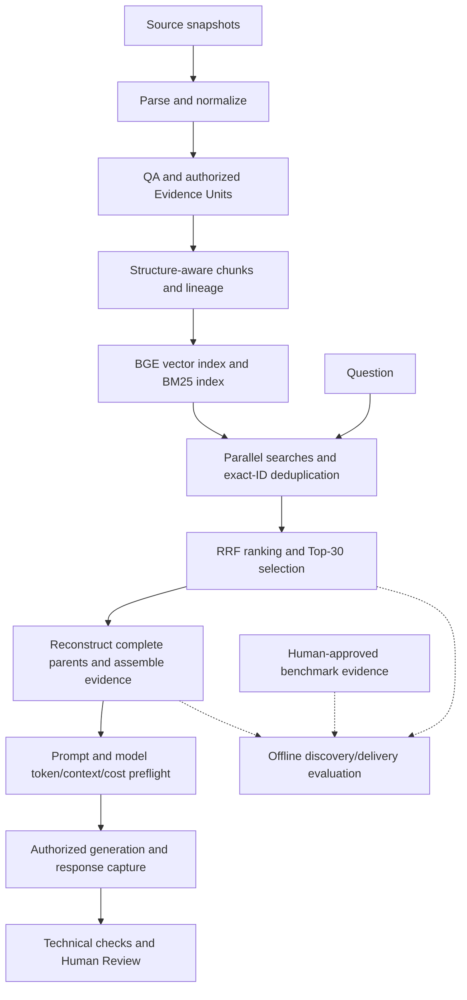

# RAG Intelligence Hub

## Week 2 project submission — revised draft for owner review

**Prepared:** November 2, 2026 · **Use case:** Bring my own · **Track:** Code-based Python  
**Status:** Unpublished draft for review. Detailed evidence follows in appendices.

## 1. The problem I chose to solve

A developer learning RAG may struggle to connect explanations to evidence. For example: **“In the original RAG paper abstract, what are the parametric and non-parametric memory components of the model?”** Answering requires the right passage, its context and traceable attribution.

I built **RAG Intelligence Hub** so learners can ask questions, inspect source-linked answers or evidence gaps, and trace preparation, retrieval and evaluation. Its value is answering and diagnosing *why* an answer succeeded or failed.

For the Academy's two choices, I selected **my own use case** and **the code-based track**, using Python and LangChain components. The deterministic workflow did not require LangGraph. [E1]

**One-liner:** My RAG app helps AI learners and builders answer RAG fundamentals, implementation and design questions from 16 curated research papers and technical documents in Streamlit, targeting **≥95% claim-level faithfulness**.

That is a project target, **not an achieved score**. Faithfulness requires claims to be supported by the evidence supplied to the model; fluent wording and valid citations alone cannot establish it.

## 2. Scope, corpus and stack

| Framework decision | What I implemented |
| --- | --- |
| Corpus and authority | Four PDFs, one Markdown document and eleven HTML sources covering RAG foundations, chunking, retrieval and evaluation. Original publishers remain the technical authority. |
| Ingestion and freshness | Parse format-specific content, normalize Sections, review permitted scope and publish versioned evidence. Updates are explicit; there is no continuous refresh service or demonstrated freshness SLA. |
| Chunking and embeddings | Structure-aware chunks with parent–child lineage; normally 384 BGE tokens, four approved exceptions up to 512, zero added overlap; local `BAAI/bge-small-en-v1.5` vectors. |
| Retrieval and answering | BM25 plus BGE vector search, RRF Top-30, complete-parent evidence within 128K BGE tokens, then model preflight and grounded generation. |
| Quality and latency | Independent grounding/completeness review, explicit missing-evidence behavior and measured timing. Initial faithfulness and p95 ≤10-second targets are not demonstrated. |

The accepted composition contains **553 Evidence Units, 992 chunks and 992 saved vectors** across 16 documents. The 3,040 canonical Sections include **358 PDF Sections on HOLD**, unavailable as independent evidence. These counts describe different objects, not a one-to-one conversion. Appendix A lists the corpus. [E2, E3]

The stack uses Python 3.12, Pydantic and isolated `uv` locks; PyMuPDF, markdown-it-py and dedicated HTML ingestion; LangChain text splitters; Sentence Transformers; persistent Chroma; `rank-bm25`; an OpenAI adapter with recorded model identifier `gpt-6-luna`; and Streamlit. Tests use pytest, Ruff and AppTest, supplemented by selected browser checks. LangSmith/Ragas are corpus sources, not evaluation services I executed. [E4]

## 3. How the architecture works



**Preparation:** Parsing produces blocks; normalization creates Sections. QA publishes authorized Evidence Units with context, provenance and restrictions. Smaller chunks support search while their complete parents remain the citation authority. I preserved these relationships instead of treating isolated snippets as complete evidence. [E3]

**Retrieval:** BM25 finds lexical matches; BGE finds semantic neighbors. Each supplies up to 50 results. Exact Chunk IDs are combined, preserving both search ranks. RRF adds `1 / (60 + search rank)` per contributing search and retains Top-30. Here, 60 is a scoring constant, not Top-60. No neural reranker is active. [E5]

**Verified delivery:** Chunks resolve to complete parent units, considered in candidate-rank order. Each parent is included whole or omitted with a reason. The **128K BGE budget covers serialized evidence**, including required context, citations and qualifications. It excludes later prompt/model overhead. BGE counts are not generator-token counts. Labels never inject missing evidence into requests. [E6]

**Answering:** Preflight revalidates sources and checks model access, exact provider-counted input, context and cost. Current instructions use prompt v2.2/schema 2.0 with 4,096 reserved output tokens and a 1,024-token margin. They require claims, citations, qualifications and missing-information explanations. Historical prompt versions remain preserved. [E7]

**Milestone boundaries:** Ingestion/QA precede M0. M0 defines the contract; M1 prepares units; M2 chunks; M3 catalogs lineage; M4 embeds; M5 stores vectors; M6 indexes BM25; M7 retrieves/ranks; M8 reconstructs/assembles; M9 evaluates retrieval offline; M10 integrates grounded generation. Subsequent technical and human assessments remain distinct from M9. Appendix E uses the same mapping. [E17]

## 4. My implementation journey

### Finding a useful chunking baseline

**Problem:** Uniform text slicing could lose structure. **Hypothesis:** Structure-aware chunks could preserve useful boundaries within a manageable token budget. **Experiment:** Compare 256 and 384 BGE-token configurations on C01's 61 units. **Observation:** They produced 114 and 88 pieces respectively; both preserved approved display content. **Engineering decision:** Retain 384 as the engineering baseline, with bounded exceptions. **Learning:** Fewer splits and preserved content do not prove better retrieval; that requires separate evaluation. [E3]

### Choosing how to combine search results

**Problem:** Keyword and semantic searches can find different evidence. **Hypothesis:** Fusion or a neural reranker might improve useful ordering. **Experiment:** First compare BM25, vector and hybrid retrieval; then compare RRF and MiniLM on identical pools for 15 frozen questions/22 evidence groups. **Observation:** MiniLM completed Top-10 requirements for 10/15 questions versus RRF's 8/15, but had mixed regressions and warm median ranking time around 2,544 ms versus 0.212 ms. **Engineering decision:** Retain RRF under D051. **Learning:** A local quality improvement must justify its latency and complexity; hybrid did not beat BM25 on every baseline metric. [E5, E9, E10]

### Separating discovery from delivery

**Problem:** Finding a supporting chunk did not ensure its complete parent reached the model. **Hypothesis:** Selection depth and evidence budget were separate bottlenecks. **Experiment:** Compare RRF Top-10/20/30 and alternative selections, then test three delivery arms over eight budgets from 4K–128K. **Observation:** Top-30 retained direct witnesses for 20/22 groups; at 128K it delivered 19/22 and complete evidence for 12/15 questions. **Engineering decision:** Carry Top-30/128K into the expanded experiment. **Learning:** More candidates cannot remove a budget constraint, and more budget cannot recover evidence excluded by selection. This is the strongest tested configuration in that study, not a universal optimum. [E6, E9]

### Learning from real responses

**Problem:** Real outputs exposed formatting failures and lost rejected-response diagnostics. **Hypothesis:** Separating evidence integrity, quotation fidelity and semantic quality would make findings more useful. **Experiment:** Q04 canary, four-question pilot, then seven four-question batches, with offline investigations and versioned fixes. **Observation:** Q04's eight quotations mapped to authentic sources despite PDF formatting differences; other outputs had genuine reference/contract defects. **Engineering decision:** Adopt ADR D052 and capture future raw responses before parsing, retaining rejection and Human Review. **Learning:** Preserve what the model returned without converting a diagnostic response into a valid answer. [E8, E12]

All comparisons are developmental, not untouched held-out evaluations. Appendix G retains detailed scopes and alternatives; results using different scoring definitions are not pooled.

## 5. One recorded question, end to end

This walkthrough uses **M9-Q01 from one sealed pilot run**, `20261029T154158-live-a83ec5c6833f`. It is not regenerated or combined with another response. The question is the original-paper memory question in the introduction. [E16]

**Input to context:** Saved Top-30 candidates resolved to **27 distinct parents → 17 included, 10 omitted**, using **126,417 / 128,000 BGE tokens**. The recorded request used **prompt v2.1**, not today's v2.2. Fresh provider qualification counted **87,615 input tokens** and passed context/cost checks.

**Exact saved answer:**

> The abstract identifies the **parametric memory** as a pre-trained sequence-to-sequence (seq2seq) model, and the **non-parametric memory** as a dense vector index of Wikipedia, accessed using a pre-trained neural retriever. The source evidence is from the paper’s abstract; the supplied record notes that its publication authorization has expired, though source integrity and complete-paragraph approval were verified.

**Citations:** Both reported claims reference the **same supplied C01 abstract Evidence Unit**, on page 1 of the original RAG paper. Each carries a supporting quotation; both recorded **EXACT_MATCH**. The two checks are not two independent sources. Full Unit ID, quote and hashes are in Appendix H. Citations are stored in structured claim fields; none was added to the answer above.

**Outcome:** The model declared ANSWERED and passed structure/citation checks. Technical validation remained **REVIEW_REQUIRED**, including unresolved qualification applicability. A later matching **OWNER_APPROVED_POC** decision did not rewrite that original verdict or establish formal independent validation. The expiry wording above is the model's recorded disclosure, not a newly verified publisher fact.

Usage was **87,615 input + 758 output = 88,373 tokens**, costing an estimated **$0.0113308** from recorded usage/pricing. Native question runtime was **125.778 seconds**; the HTTP request took **6.142 seconds**. Current raw-capture functionality came later: this example uses the sealed structured response, not a retained original HTTP body. [E13, E16]

## 6. What the results establish

The expanded benchmark contains **34 questions: 31 answerable and 3 unsupported controls**, with **40 mandatory human-approved evidence groups**. Each question has its own required groups. Unsupported controls have no positive-group recall denominator; retrieved neighbors do not make them answerable. [E11]

| Measurement | Verified result | Meaning |
| --- | --- | --- |
| Supporting parent discovery | **39/40 groups** | Search selection located approved supporting parents. |
| Verified evidence delivery | **36/40 groups** | Required evidence reached context; complete delivery covered **27/31 answerable questions**. |
| Generation attempts | **34/34 questions** | Every question was attempted; not every returned output was accepted. |
| Accepted structured responses | **29/34** | Five latest responses were contract-rejected: Q12, Q18, R01, R02, R04. |

R03's known-positive parent was cut off by Top-30 selection; Q23, Q26 and R04 lost required evidence through budget displacement. Alternative sources may support some claims, but missing labeled evidence is not automatically an incorrect answer—or proof of completeness.

These four acceptance layers remain explicit:

| Layer | What it establishes | Current status |
| --- | --- | --- |
| Contract acceptance | Parseable structure and allowed response relationships. | 29 accepted; five rejected. |
| Technical validation | Source/citation integrity and fidelity findings. | 22 review-required, nine failed, two rejected/post-checks not run, one indeterminate. |
| Local POC approval | Exact-answer-bound owner attestation. | Four approved; 24 pending, R03 completeness accepted/grounding pending, five diagnostic-only. |
| Independent semantic acceptance | Qualifying evidence-aware grounding, completeness and disclosure assessment. | Zero formally independently VALIDATED answers recorded. |

A Local POC approval is useful but is not authenticated independent validation. R03 still has partly supported BM25/Contextual BM25 wording; Q29 declared ANSWERED on an unsupported control. Both need honest review. The historical baseline's macro Recall@10 was 82.1% for BM25/hybrid and 69.2% for vector; Appendix G preserves its distinct 26-answerable/31-group scope. Precision, nDCG and an aggregate achieved faithfulness score were not established. [E8, E10–E12]

## 7. Cost, latency and operational limits

Known benchmark attempts cost an estimated **$0.384996335**, using measured tokens and saved pricing. One earlier Q05 failure has unknown cost, so this is not a complete invoice total; it excludes Bot requests, local compute and development. Reservations and projected ceilings remain separate. [E12]

Latency is the main operational weakness. Pilot evidence reconstruction took roughly 105–127 seconds per question; generation HTTP calls took 3–15 seconds. A later full Bot request, BOT-000006, took **8m 33.22s**, with about **18.65s** in its generation stage. Its full-dispatch scope differs from Q01's native runner timing. These observations neither meet the original latency objective nor establish p95. [E13]

Normal Chat is type → Send → answer or clear stop reason. Automatic checks enforce **$0.03 per question/$1.00 persistent Bot cap**, one paid answer per submission, no automatic retry/fallback. Saved telemetry and Human Review expose status, output, timings and diagnostics without executing requests on refresh. Each question starts fresh; there is no conversation memory or answer cache. [E7, E14]

## 8. What I learned with Codex

I used Codex to inspect contracts, propose bounded implementations, write tests, investigate failures and improve the UI. I chose which changes to approve and authorized paid stages separately. For example, instead of adopting MiniLM solely for its Top-10 gain, I retained the simpler measured RRF trade-off. After Q04, I approved separating harmless quotation formatting from factual support while keeping citation integrity strict.

Codex helped expose lost rejected output, ambiguous qualifications and icon clipping missed by tests. Versioned fixes preserved historical failures. Claude/Gemini/ChatGPT observations on R03 remain disagreement data, not grounding certification. AI assistance supplied neither missing evidence nor owner approval. [E8, E9, E12, E14]

The broader learning is that **retrieval, verified delivery and answer quality must be measured separately**. This remains a small, curated POC with incomplete semantic review, held source material, known test/import/lint limitations and no claim of achieved 95% faithfulness or production readiness. Future work includes repeated-reconstruction overhead and broader independent evaluation; it is not implemented here. [E2, E15]

## 9. Using the application — RAG Bot and dashboards

**8516 is the current application**, combining the RAG Bot with the Knowledge Workspace. [E14]

| Page | Purpose |
| --- | --- |
| RAG Bot | Ask a question; receive a grounded answer, partial answer or insufficient-evidence explanation. |
| Knowledge Preparation | Trace sources through parsing, QA, chunking, embeddings and indexing. |
| Knowledge Retrieval | Inspect search results, ranking and assembled evidence. |
| Offline Retrieval Evaluation | Explore experiments, evidence coverage and configuration decisions. |
| Pre-Generation | Inspect prompt preparation, token counts, context fit and projected cost. |
| Generation | Inspect answers, failures, usage, cost and latency. |
| Post-Generation Evaluation | Understand technical findings and unresolved answer-quality assessments. |
| Human Review | Review evidence and record explicit owner decisions. |

**8514 is the preserved Master Dashboard**, retaining historical Explorer views, preflight/runner histories and the full benchmark tracker with exports. Dashboard views reuse existing versioned artifacts. Remaining capabilities should be migrated before considering retirement; Appendix I details the backlog and approval boundary. [E18]

## 10. Submission and reproduction boundary

The 8516 launch command is in Appendix E. Existing locked environments and private source, publication, model, index and trust inputs are required. Clean-checkout reproduction, a reviewed GitHub package and evaluator-accessible evidence remain pending.

The handout requires a **Google Doc**, a **video of five minutes or less** explaining the application and AI coding-tool use while demonstrating an actual result, and a **GitHub asset link**. October 18 is the Builder of the Week deadline; later certification submission is permitted. November 11 appears only in the separately identified supplied PDF version; Appendix F records that provenance and requests owner confirmation of the applicable cutoff. [E1]

Before submission, review first-person statements, clear publication permissions, replace private links with permitted accessible summaries, and verify all three deliverable links. No publication, new inference or submission is performed by this revision.

---

## Appendix A. Corpus inventory

The following links identify original publishers; the application uses versioned local snapshots, not guaranteed-current web content. Inclusion records local project scope, not redistribution permission.

| ID | Format | Source |
| --- | --- | --- |
| C01 | PDF | [Lewis et al., Retrieval-Augmented Generation for Knowledge-Intensive NLP Tasks](https://arxiv.org/abs/2005.11401) |
| C02 | PDF | [Gao et al., Retrieval-Augmented Generation for Large Language Models: A Survey](https://arxiv.org/abs/2312.10997) |
| C03 | HTML | [LlamaIndex, Introduction to RAG](https://developers.llamaindex.ai/python/framework/understanding/rag/) |
| C04 | Markdown | [LangChain, Build a semantic search engine](https://docs.langchain.com/oss/python/langchain/knowledge-base) |
| C05 | HTML | [LangChain, Recursive Text Splitter](https://docs.langchain.com/oss/python/integrations/splitters/recursive_text_splitter) |
| C06 | PDF | [Chroma, Evaluating Chunking Strategies for Retrieval](https://www.trychroma.com/research/evaluating-chunking) |
| C07 | HTML | [Pinecone, Chunking Strategies for LLM Applications](https://www.pinecone.io/learn/chunking-strategies/) |
| C08 | HTML | [Pinecone, Index Data Overview](https://docs.pinecone.io/guides/index-data/indexing-overview) |
| C09 | HTML | [Anthropic, Contextual Retrieval](https://www.anthropic.com/engineering/contextual-retrieval) |
| C10 | HTML | [Microsoft Azure AI Search, RRF Scoring](https://learn.microsoft.com/en-us/azure/search/hybrid-search-ranking) |
| C11 | HTML | [Sentence Transformers, Retrieve & Re-Rank](https://sbert.net/examples/sentence_transformer/applications/retrieve_rerank/README.html) |
| C12 | HTML | [n8n, Retrieve Relevant Context](https://docs.n8n.io/build/integrate-ai/understand-ai-components/retrieve-relevant-context) |
| C13 | HTML | [Pinecone Assistant Overview](https://docs.pinecone.io/guides/assistant/overview) |
| C14 | PDF | [Liu et al., Lost in the Middle](https://arxiv.org/abs/2307.03172) |
| C15 | HTML | [Ragas, Available Metrics](https://docs.ragas.io/en/latest/concepts/metrics/available_metrics/) |
| C16 | HTML | [LangSmith, Evaluate a RAG Application](https://docs.langchain.com/langsmith/evaluate-rag-tutorial) |

## Appendix B. Benchmark outcomes and stage accounting

The tables below are a documentation snapshot from the existing verified readers. They do not run evaluation or modify verdicts. Model status is a declaration; a rejected contract does not become accepted because an answer string was returned. All Q-prefixed IDs below retain their canonical `M9-` prefix.

### B1. Latest logical result per question

“Accepted” below means the structured response contract was accepted, not the answer quality. “Failed” refers to the technical evaluation dimension; substantive claim truth requires evidence-aware review. Costs use the selected attempt, excluding earlier attempts for that question.

| Stage | Question | Model status | Contract | Technical outcome | Owner review | Selected-attempt cost USD |
| --- | --- | --- | --- | --- | --- | ---: |
| Historical | M9-Q05 | ANSWERED | Accepted | Indeterminate | Pending | 0.011198925 |
| Canary | M9-Q04 | ANSWERED | Accepted | Review required | Approved (Local POC) | 0.0116498 |
| Pilot | M9-Q01 | ANSWERED | Accepted | Review required | Approved (Local POC) | 0.0113308 |
| Pilot | M9-Q09 | ANSWERED | Accepted | Review required | Approved (Local POC) | 0.011183925 |
| Pilot | M9-Q27 | ABSTAINED | Accepted | Review required | Approved (Local POC) | 0.010736675 |
| Pilot | R03 | ANSWERED | Accepted | Review required | Completeness accepted; grounding pending | 0.011612675 |
| Batch 1 | M9-Q02 | ANSWERED | Accepted | Review required | Pending | 0.0114413 |
| Batch 1 | M9-Q03 | PARTIAL | Accepted | Failed | Pending | 0.011457465 |
| Batch 1 | M9-Q06 | ANSWERED | Accepted | Review required | Pending | 0.01048359 |
| Batch 1 | M9-Q07 | ANSWERED | Accepted | Failed | Pending | 0.01034109 |
| Batch 2 | M9-Q08 | ANSWERED | Accepted | Review required | Pending | 0.010786215 |
| Batch 2 | M9-Q10 | ANSWERED | Accepted | Failed | Pending | 0.01071359 |
| Batch 2 | M9-Q11 | ANSWERED | Accepted | Review required | Pending | 0.010792215 |
| Batch 2 | M9-Q12 | UNAVAILABLE | Rejected | Post-checks not run | Diagnostic triage | 0.01075759 |
| Batch 3 | M9-Q13 | ANSWERED | Accepted | Review required | Pending | 0.01092684 |
| Batch 3 | M9-Q14 | ANSWERED | Accepted | Review required | Pending | 0.011260715 |
| Batch 3 | M9-Q15 | ANSWERED | Accepted | Review required | Pending | 0.011230465 |
| Batch 3 | M9-Q16 | ANSWERED | Accepted | Review required | Pending | 0.011168465 |
| Batch 4 | M9-Q17 | ANSWERED | Accepted | Review required | Pending | 0.011043215 |
| Batch 4 | M9-Q18 | ANSWERED | Rejected | Post-checks not run | Diagnostic triage | 0.010757925 |
| Batch 4 | M9-Q19 | ANSWERED | Accepted | Review required | Pending | 0.01131555 |
| Batch 4 | M9-Q20 | ANSWERED | Accepted | Review required | Pending | 0.01098334 |
| Batch 5 | M9-Q21 | ANSWERED | Accepted | Review required | Pending | 0.0108823 |
| Batch 5 | M9-Q22 | ANSWERED | Accepted | Review required | Pending | 0.010904715 |
| Batch 5 | M9-Q23 | PARTIAL | Accepted | Failed | Pending | 0.01076034 |
| Batch 5 | M9-Q24 | ANSWERED | Accepted | Review required | Pending | 0.010318965 |
| Batch 6 | M9-Q25 | ANSWERED | Accepted | Failed | Pending | 0.010863965 |
| Batch 6 | M9-Q26 | ANSWERED | Accepted | Review required | Pending | 0.01108159 |
| Batch 6 | M9-Q28 | ABSTAINED | Accepted | Review required | Pending | 0.01049884 |
| Batch 6 | M9-Q29 | ANSWERED | Accepted | Review required | Pending | 0.010655465 |
| Batch 7 | R01 | ANSWERED | Rejected | Failed | Diagnostic triage | 0.0120683 |
| Batch 7 | R02 | PARTIAL | Rejected | Failed | Diagnostic triage | 0.009789715 |
| Batch 7 | R04 | PARTIAL | Rejected | Failed | Diagnostic triage | 0.01195884 |
| Batch 7 | R05 | PARTIAL | Accepted | Failed | Pending | 0.011467715 |

### B2. Spending across all recorded attempts

These totals include earlier failures and separately authorized recovery. They therefore differ from adding selected-attempt costs above. An unknown cost is not zero.

| Stage | Unique questions | Recorded attempts | Known usage-based estimated cost USD | Unknown-cost attempts |
| --- | ---: | ---: | ---: | ---: |
| Historical | 1 | 2 | 0.011198925 | 1 |
| Canary | 1 | 1 | 0.0116498 | 0 |
| Pilot | 4 | 4 | 0.044864075 | 0 |
| Batch 1 | 4 | 4 | 0.043723445 | 0 |
| Batch 2 | 4 | 4 | 0.043049610 | 0 |
| Batch 3 | 4 | 4 | 0.044586485 | 0 |
| Batch 4 | 4 | 5 | 0.054673245 | 0 |
| Batch 5 | 4 | 4 | 0.042866320 | 0 |
| Batch 6 | 4 | 4 | 0.043099860 | 0 |
| Batch 7 | 4 | 4 | 0.045284570 | 0 |
| **Total** | **34** | **36** | **0.384996335** | **1** |

Q12 has no retained raw output. Q18’s latest rejected recovery and R01/R02/R04 have captured raw responses; originals and attempt history remain separate. Rejected candidates can be inspected in Human Review diagnostics but cannot be approved as accepted structured answers.


## Appendix C. Evidence and reproduction references

These project-relative links are for local review. Private `data/` and `workspace/` artifacts are intentionally absent from an ordinary public checkout; prepare permitted, redacted extracts or accessible summaries before sharing the Google Doc. Publisher bodies, complete evidence packages and credentials are not reproduced here.

| Ref | Evidence supporting this report |
| --- | --- |
| E1 | Academy *Week 2 Project Handout (Oct 2026)*: common framework/submission requirements on pp. 1–3 and 7–8. **Two reviewed private PDF versions differ on the certification cutoff; Appendix F identifies their page-1 wording and hashes separately.** No independently verified Academy notice was supplied beyond these copies. |
| E2 | [Original framework and project-defined targets](../../workspace/Project-KickOff-Docs/RAG_Intelligence_Hub_Week2_Part1_Part2_Blueprint_2026-10-18.md). This is an initial planning record, not a current implementation-status authority. |
| E3 | [Accepted catalog and lineage handoff](../M3_TO_M4_HANDOFF.md), [chunk-size pilot](../M2_CHUNKING_VERIFICATION.md), [local embedding baseline](../LOCAL_EMBEDDINGS.md), [initial sources](../../config/sources.json), [HTML source registry](../../config/html-sources.json). |
| E4 | Locked environments: [root](../../pyproject.toml), [chunking](../../tools/chunking/pyproject.toml), [embeddings](../../tools/embeddings/pyproject.toml), [vector index](../../tools/indexing/pyproject.toml), [BM25](../../tools/lexical/pyproject.toml), [generation](../../tools/generation/pyproject.toml), [dashboard](../../apps/ingestion_dashboard/pyproject.toml); each has its own `uv.lock`. |
| E5 | [Candidate retrieval contract](../M7_HYBRID_RETRIEVAL.md), [public retrieval service](../../tools/retrieval/service.py), [RRF decision D051](../adr/D051-rrf-ranking-decision-v1.md). |
| E6 | [Evidence assembly contract](../M8_VERIFIED_EVIDENCE.md), [public EvidenceService](../../tools/evidence/service.py), [budget study](../../data/evals/m8-delivery/experiment-v1/REPORT.md). |
| E7 | [Preflight Suite](../RAG_PREFLIGHT_SUITE.md), [generation settings v2.2](../../tools/generation/settings-v2.2.json), [prompt v2.2](../../tools/pre_generation_gate/grounded-generation-prompt-v2.2.txt), [response contract](../../tools/pre_generation_gate/response_v2.py), [current Bot operation](../RAG_BOT_RUNTIME.md), [native trust gate](../GENERATION_NATIVE_TRUST_GATE.md). |
| E8 | [ADR D052](../adr/D052-semantic-grounding-validation-v2.md), [answer-quality contract and fidelity successor](../ANSWER_QUALITY_VALIDATION_V2.md), [Human Review](../HUMAN_REVIEW_WORKFLOW.md), [response observation and diagnostic review](../RESPONSE_OBSERVATION_AND_REVIEW.md). |
| E9 | [Ranking metrics](../../data/evals/ranking/phase3-experiment-v1/RETRIEVAL_METRICS.json), [RRF/MiniLM decision and timings](../adr/D051-rrf-ranking-decision-v1.md), [selection experiments as displayed](../../apps/knowledge_preparation/offline_evaluation.py), [budget comparison](../../data/evals/m8-delivery/experiment-v1/REPORT.md). |
| E10 | [Historical retrieval evaluation](../M9_RETRIEVAL_EVALUATION.md), [original measured results](../../data/evals/m9/runs/m9-v3/RESULTS.json). |
| E11 | [Expanded benchmark manifest](../../data/evals/expanded-benchmark/v1/MANIFEST.json), [34-question retrieval/delivery completion report](../../data/evals/benchmark-completion/v1/REPORT.md). |
| E12 | [Verified benchmark tracker](../../tools/benchmark_tracker/adapter.py), [original tracker snapshot](../../data/evals/generation-runner-reviews/final-benchmark-tracker-v1/TRACKER_SNAPSHOT.json), [R03 source-grounding findings](../../data/evals/generation-runner-reviews/r03-owner-completeness-v1-review/REPORT.md), [Batch 7 actual failures](../../data/evals/generation-runner-reviews/batch07-live-v1/REPORT.md). Fresh documentation readback is retained privately in [CURRENT_BENCHMARK_READBACK.json](../../workspace/submission/week2-documentation-v2/CURRENT_BENCHMARK_READBACK.json). |
| E13 | [Pilot execution report](../../data/evals/generation-runner-reviews/live-pilot-native-v1/REPORT.md), [stage-timing definitions](../GENERATION_STAGE_TIMINGS.md), [shared timing aggregation](../../apps/knowledge_preparation/run_summary.py), [BOT-000006 full dispatch trace](../../workspace/bot-dispatch-traces/dispatch-17d9cb04755c4d71912b032552ea5c70/REQUEST_TRACE/), [BOT-000006 generation timings](../../data/evals/generation-runner/20261102T085338-live-4fe2d3969265/questions/BOT-000006/STAGE_TIMINGS.json). |
| E14 | [Current workspace/UI guide](../KNOWLEDGE_PREPARATION_PREVIEW.md), [shared overview verification](../../workspace/rag-bot/review-summary-table-v1/FINAL_VERIFICATION.json), [default Chat correction](../../workspace/rag-bot/default-chat-send-v1/REPORT.md), [icon visual verification](../../workspace/rag-bot/header-icon-clipping-v1/REPORT.md). |
| E15 | [Regression scopes and prerequisites](../REGRESSION_VERIFICATION.md), [deferred enhancement candidates](../WEEK3_DEFERRED_ENHANCEMENTS.md), [source-use and dependency boundaries](../dependencies.md). |
| E16 | **Q01 single-run walkthrough:** [sealed pilot run](../../data/evals/generation-runner/20261029T154158-live-a83ec5c6833f/MANIFEST.json), [question seal](../../data/evals/generation-runner/20261029T154158-live-a83ec5c6833f/questions/M9-Q01/QUESTION_RESULT_MANIFEST.json), [captured structured response and original validation](../../data/evals/generation-runner/20261029T154158-live-a83ec5c6833f/questions/M9-Q01/RESULT.json), [local source/evidence binding](../../data/evals/generation-runner/20261029T154158-live-a83ec5c6833f/questions/M9-Q01/LOCAL_VALIDATION.json), [run-sealed timing receipt](../../data/evals/generation-runner/20261029T154158-live-a83ec5c6833f/questions/M9-Q01/STAGE_TIMINGS.json), [later exact-answer-bound Local POC approval](../../data/evals/human-review/local-poc/poc-5a6b72d5915c4a51887fa831f3625de8/MANIFEST.json). All are private audit references, not publicly accessible submission links. |
| E17 | [Master milestone definitions](../../workspace/rag-implementation/v1/MILESTONE_TRACKER.json), cross-checked with [milestone history](../milestones.md), [M0 contract](../CHUNK_PREPARATION_CONTRACT.md), [M1 preparation](../M0_M1_VERIFICATION.md) and component contracts E3–E8. IDs identify responsibilities, not a claim that every historical tracker status is current. |
| E18 | [Preserved 8514 launcher](../../apps/master_dashboard/canonical.py), [8514 navigation](../../tools/generation_runner/ui.py), [8516 navigation](../../apps/knowledge_preparation/app.py), [historical Explorer view](../../apps/master_dashboard/views/explorer.py), [8516 retrieval projection](../../apps/knowledge_preparation/retrieval_explorer.py), [preflight run view](../../tools/preflight_suite/dashboard.py), [8516 pre-generation view](../../apps/knowledge_preparation/pre_generation.py), [runner history/timing view](../../tools/generation_runner/dashboard.py), [full benchmark tracker](../../tools/benchmark_tracker/ui.py), [registered-artifact viewer](../../tools/quality_dashboard/ui.py), [exact review handoff](../../apps/knowledge_preparation/review_context.py). These source references support the deferred parity inventory in Appendix I; they are not published demo URLs. |

Historic documents retain delivery-time descriptions such as “pending” or “not authorized.” Subsequent owner decisions and exact result/approval records establish later events; this report does not rewrite those older records. Documentation readback made no provider calls and did not rerun retrieval, assembly or generation.

## Appendix D. Prompt design and submission checklist

The current prompt organizes instructions into role, goal, context, instructions, constraints, a synthetic example and output format. It uses three ordered messages: trusted system instructions, the original question and authorized evidence marked as lower-trust data. The JSON response schema is a separate request field. Benchmark labels are not inserted into the generation prompt.

In plain English, it directs the model to answer from supplied source content, associate claims with authorized Unit IDs and supporting quotations, preserve applicable qualifications, disclose missing information and conflicts, and select ANSWERED, PARTIAL or ABSTAINED. For abstention, the answer stays empty and `missing_information` explains why the supplied evidence cannot establish the requested answer. These instructions encourage grounded behavior; they do not prove that the model obeyed them. The [versioned template](../../tools/pre_generation_gate/grounded-generation-prompt-v2.2.txt) provides the exact wording without any publisher payload.

The benchmark is not a uniform prompt-version A/B test. Historical Q05 used v2; Q04 and the pilot used v2.1; the seven remaining batches used v2.2. Earlier answers, source bindings and verdicts were retained rather than regenerated to create a cleaner comparison.

Before submission:

- [ ] Owner reviews factual wording, first-person learning statements and the reported limitations.
- [ ] Transfer the approved main report and selected appendices to Google Docs; render the Mermaid diagram as an image if needed.
- [ ] Add the real GitHub assets URL after a separate reviewed source-release and reproducibility check.
- [ ] Replace private audit links with permitted accessible summaries where the evaluator needs them.
- [ ] Add the final video URL; keep it within five minutes and disclose any shortened processing wait.
- [ ] Confirm evaluator access to all three submission links and complete the official form separately.

October 18 applies to Builder of the Week; both reviewed handouts permit later submission. Confirm any certification cutoff using the version-specific evidence in Appendix F. Live form availability remains unverified; nothing has been submitted.


## Appendix E. Consistent engineering milestone map

Source acquisition, parsing, normalization, source QA and authoritative Evidence Unit publication **precede M0**. They are not created by the baseline/chunking contract. Older ingestion “Milestone 1/2/2.5” labels are a separate historical numbering scheme. [E17]

| ID | Master-plan name | Responsibility |
| --- | --- | --- |
| M0 | Baseline and chunking contract | Define a common input contract and preservation rules for already verified units. |
| M1 | Chunk preparation | Prepare and profile those units for chunking without expanding source scope. |
| M2 | Structure-aware chunking | Create source-respecting pieces under explicit token/boundary rules. |
| M3 | Chunk catalog | Publish stable Chunk IDs and Section–Unit–chunk lineage. |
| M4 | Embeddings | Generate and retain local BGE vector representations. |
| M5 | ChromaDB | Store/index the saved vectors and their bound identities. |
| M6 | BM25 | Build the separate lexical index over authorized search representations. |
| M7 | Hybrid search | Query indexes, combine exact IDs, rank candidates and select results. |
| M8 | Evidence reconstruction | Reopen and validate complete parents, deduplicate units and assemble budgeted evidence. |
| M9 | Retrieval evaluation | Compare offline evidence discovery and delivery using approved questions/labels. |
| M10 | Grounded generation | Integrate request/prompt preparation, provider qualification, authorized generation and result telemetry. |

Post-generation technical evaluation and Human Review are downstream capabilities in the delivered generation/review workstream, not M9 retrieval evaluation. M11 is the separately defined final demonstration; this report does not claim it accepted or submitted. No engineering authorization changes follow from this map.

### Source-flow example

For C01, the saved relationships are:

**409 parsed blocks → 406 canonical Sections → 277 admitted Sections → 61 Evidence Units → 88 retrieval chunks → 88 saved embeddings → 88 vector-index records + 88 BM25 records.**

The remaining Sections are 110 HOLD and 19 excluded. Multiple Sections can form a unit; units can produce multiple chunks; supporting context can be shared. Counts do not imply one-to-one conversion. HOLD/excluded Sections do not gain authority through chunking.

The 384-token default is an engineering choice, not the vector dimension expressed as chunk size; both happen to be 384. Four exceptions contain 385, 474, 485 and 507 BGE tokens within a 512-token limit. Zero added overlap does not imply no shared context across distinct parents.

### Local launch and reproducibility boundary

On the prepared project machine, from the repository root:

```sh
PYTHONPATH=. apps/ingestion_dashboard/.venv/bin/python -m streamlit run apps/knowledge_preparation/app.py --server.address 127.0.0.1 --server.port 8516 --server.headless true --browser.gatherUsageStats false
```

Open `http://127.0.0.1:8516`. This is a local launch command, not a verified clean-clone installation procedure. Existing permitted sources, model/index assets, publications, trust records and locked environments are required. Opening saved telemetry does not authorize inference; a live Chat Send invokes the existing paid-execution safeguards. No installer, environment or runtime was changed for this revision.

## Appendix F. Deadline provenance and publication checklist

### What the supplied evidence actually says

| Evidence | Verified provenance | Deadline supported |
| --- | --- | --- |
| Original project-kickoff handout, page 1 | Private kickoff PDF SHA-256 `e94e45b3a47ff8f8269ed1325286428c28508453d394140c2b581476c6e20606` | October 18, 2026, 11:59pm PT for Builder of the Week; later submission permitted. **No November 11 cutoff stated.** |
| Separately supplied handout copy, page 1 | Owner-supplied PDF SHA-256 `7da9620c2ab86d28e97bc830f60e0e565dd154b6fe0494b9691686364dbf537d` | Repeats October 18/later submission and additionally states November 11, 2026 as the final certification deadline. |
| Independent Academy deadline notice | None provided or verified in this documentation task | No further corroboration. **Owner must confirm which copy governs or obtain current Academy confirmation.** |

Both page-1 statements were extracted and visually inspected, not inferred from a filename or earlier project notes. The later supplied copy is separate evidence for November 11; that date must not be attributed to the original kickoff handout. Both copies' page 8 requires Google Doc + ≤5-minute video + GitHub assets. The handout's optional chatbot add-on is implemented; it does not add a certification pass guarantee.

### Evidence accessibility

- `docs/`, source files and configs are **repository-relative references**, not evidence that they have been published. Several current files remain outside Git's tracked inventory; no configured remote was found during the prior read-only audit. Recheck the publication inventory before release.
- `data/` and `workspace/` links—including original responses, owner approvals, private handouts, evaluation receipts and milestone tracker—are **private/local audit evidence**. They will not resolve for an evaluator from the Google Doc or ordinary GitHub clone.
- Publisher URLs identify **external originals**, not the exact frozen snapshots. They were taken from project records; current reachability was not tested during this revision.
- Localhost URLs work only on the prepared machine. The final video and permitted screenshots/exports should convey the evidence without implying a hosted application exists.

### Submission-safe publication checklist — owner action required

- [ ] Confirm the applicable deadline/version and verify the submission form is accessible.
- [ ] Approve first-person descriptions, learning statements and the exact Q01 disclosure wording as an unedited model output.
- [ ] Review the complete source inventory and provide the real GitHub URL. Do not assume an ordinary Git archive includes current untracked implementation.
- [ ] Document locked environments and permitted acquisition/reconstruction prerequisites. Test the intended handoff separately before claiming clean-clone reproducibility.
- [ ] Check source/dependency licensing and sharing permissions. Do not upload publisher bodies, private source packages, raw API captures, credentials, signing material or recovery data by default.
- [ ] Prepare permitted redacted metric/result extracts and screenshots for E9–E16. Preserve IDs, counts, failures and trust labels; redact sensitive payloads without changing their meaning. Redacted extracts must be clearly labeled, not represented as byte-identical originals.
- [ ] Replace private/internal links with accessible approved extracts or retain them only as an explicitly unavailable audit appendix. Recheck links from an evaluator's account.
- [ ] Transfer the approved report into Google Docs, render the Mermaid diagram and inspect layout. Markdown word count does not establish the final page count.
- [ ] Add a ≤5-minute video covering purpose, actual result, evaluation/limitations and AI coding-tool use. Disclose shortened waiting and actual runtime.
- [ ] Verify access to Google Doc, GitHub and video, then submit separately. No real links or completion status have been fabricated here.

## Appendix G. Detailed experiment scope and historical retrieval baseline

The following descriptions retain the first draft's measured scopes. They supplement the main Problem → Hypothesis → Experiment → Observation → Engineering Decision → Learning narrative and do not form a common-denominator leaderboard.

| Experiment or iteration | Actual scope and observation | Learning and decision |
| --- | --- | --- |
| Chunk-size pilot | On C01's 61 units, 256-token and 384-token configurations produced 114 and 88 pieces respectively; both preserved the approved display content. | The 384-token version kept more units intact. It became an engineering baseline, not a demonstrated universal retrieval optimum. |
| Initial retrieval baseline | Twenty-six answerable questions and three insufficient-evidence controls; BM25, vector and RRF hybrid comparisons used final Top-10. | Measure evidence discovery separately from evidence delivered into context. Hybrid did not outperform BM25 on every metric. |
| Fair ranking comparison | Fifteen frozen questions, 22 required groups and identical saved pools: 1,294 question–chunk memberships, 534 distinct chunks. | Preserve approved alternatives and requirements that need multiple witnesses; keep candidate inputs fixed when comparing rankers. |
| RRF versus MiniLM | At Top-10, RRF covered all requirements for 8/15 questions; MiniLM with approved windows covered 10/15. Warm median ranking time was about 0.212 ms versus 2,544 ms. | MiniLM had mixed gains and regressions. Decision D051 retained RRF for the local quality, speed and complexity trade-off. These timings exclude retrieval, model loading and evidence assembly. |
| Selection depth and alternatives | RRF Top-10/20/30 retained direct witnesses for 14/18/20 of 22 groups. Intersection-first and supplementation experiments sometimes retained more. | Better candidate coverage merits a delivery test; it does not justify automatic adoption. Alternatives remain experimental. |
| Evidence-budget study | Fifteen questions, 22 groups, eight budgets from 4K to 128K. Top-30/128K delivered 19/22 groups and complete evidence for 12/15 questions. | Carry Top-30/128K forward as the selected tested configuration. More budget cannot recover a required parent removed by selection. |
| Expanded measurement completion | Reconciled 34 questions; reused 17 candidate sets and 15 compatible assembly measurements, completing the missing cases. | Reuse compatible evidence without rewriting history; keep cohort scopes and scoring definitions explicit. |
| Live canary, pilot and seven batches | Historical Q05, Q04 canary, four-question pilot and remaining 28 questions in seven groups of four. | Separate paid execution permission, captured response, contract acceptance and answer quality. Preserve failures and separately authorized recovery attempts. |

The historical baseline checked the ten highest-ranked results per method over 26 answerable questions, using 31 human-approved evidence groups. Three additional questions tested insufficient-evidence handling and had no positive-group recall denominator.

| Search method | Known-evidence Recall@10, macro | MRR@10 |
| --- | ---: | ---: |
| BM25 keyword search | 82.1% | 0.731 |
| BGE vector search | 69.2% | 0.581 |
| Hybrid: BM25 + BGE, combined with RRF | 82.1% | 0.707 |

Recall measures known evidence found, averaged across questions under historical overlap scoring. MRR measures how early support appeared. Neither measures answer correctness. **Precision and nDCG were not established:** retrieved results lacked exhaustive relevance judgments. [E10]


The frozen focused subset has 15 questions/22 groups; the earlier baseline has 26 answerable + 3 unsupported questions/31 groups; the expanded benchmark has 31 answerable + 3 unsupported/40 groups. Strict OR/joint-AND direct-witness scoring, historical overlap scoring, parent location and actual context delivery remain separately defined. A full native union has 1,294 question–chunk memberships and 534 globally distinct Chunk IDs; intersection-first and supplementation studies did not replace the active RRF policy. [E9–E11]

Initial project-defined targets were ≥95% claim-level faithfulness, Recall@5 ≥90%, citation support ≥95%, appropriate abstention ≥90% and p95 response latency ≤10 seconds. They are retained as goals from the initial blueprint, not Academy-mandated thresholds or achieved scores. No calibrated overall answer-quality percentage is inferred from the historical recall, delivered groups or Local POC decisions. [E2]

## Appendix H. Q01 walkthrough identity and citation evidence

This appendix binds the main walkthrough to **one existing pilot question result**. It is a read-only documentation check, not new reconstruction, quotation validation or semantic judging. The later owner decision is identified as a separate event for the same exact response. [E16]

| Binding | Recorded value |
| --- | --- |
| Question | M9-Q01 — In the original RAG paper abstract, what are the parametric and non-parametric memory components of the model? |
| Native run | `20261029T154158-live-a83ec5c6833f` |
| Prompt / schema | `grounded-generation-prompt-v2.1` / `grounded-response-2.0` |
| Evidence package SHA-256 | `417492d96a4764c7da6768885b57e05b0cae28384f2c148158a8a484d34be997` |
| Provider-independent assembled request SHA-256 | `b5b85676d40336c6a824e5fcda1f7ffd79a14fbd996f730adf81071961a89e11` |
| Qualified provider request SHA-256 | `7c31f5617db98da460025c88cd8504c80c08b484339a347f0e94006bee5ff5ed` |
| Parsed response SHA-256 used by review | `51363c6b4d51072407c45c0596219f96d8f45a8841aa02d9271f364bf1729a83` |
| Sealed RESULT.json SHA-256 | `12c7cad44b1613314a9ca9b24f96de2faada14319d74caf1b4e54bdc970233c4` |
| Later decision | `OWNER_APPROVED_POC`, matching question, parsed response, request and evidence hashes; not formal independent VALIDATED acceptance. |

The local prompt request and provider request use distinct identities linked by the generation audit. Likewise, the generation audit's provider-envelope response hash is distinct from the parsed-answer hash used by technical review and owner decisions; these domains must not be equated.

**Cited Evidence Unit:**

```text
pdf:e9819bbbd36305bd2f98eb00ae8d51eb1d4fc438ee563cc907aed39dcb2552c0:pdf-text-unit:C01:1de9a45098386c208c44419b
```

**Source:** C01, Lewis et al., original RAG paper abstract, page 1; recorded locators include `C01:b00007` and `C01:b00008`. Both claims reference that same unit and repeat this exact supporting quotation (line breaks retained):

```text
We introduce RAG models where the parametric
memory is a pre-trained seq2seq model and the non-parametric memory is a dense
vector index of Wikipedia, accessed with a pre-trained neural retriever.
```

The original post-validation receipt records two `RAW_SUBSTRING` / `EXACT_MATCH` checks, both with `semantic_support: NOT_ASSESSED`, against `/consumer/llm_context/source_content/0/text`, offsets 841–1037. It records citation validity PASS and overall REVIEW_REQUIRED, not a certified semantic pass. The later Local POC attestation does not erase qualification uncertainty in the original receipt.

### Timing scope for this same run

| Recorded interval | Seconds | Interpretation |
| --- | ---: | --- |
| Evidence assembly, exclusive | 108.508 | Includes actual reconstruction work across revalidations, without adding inclusive parent spans. |
| Evidence source validation, exclusive | 0.028 | Additional separately observable overhead; nested reconstruction is already charged to its own stage. |
| Prompt assembly, exclusive | 4.439 | Prompt work excluding nested evidence reconstruction. |
| Generation stage, local adapter | 6.806 | Stage interval including adapter work, broader than HTTP alone. |
| Generation HTTP request | 6.142 | Saved usage latency; not separately reported provider inference time. |
| Post-generation validation, exclusive | 0.761 | Excludes nested reconstruction already attributed elsewhere. |
| Native question end to end | 125.778 | Encloses all runner work, not the later owner review and not an independently measured full browser/Chat dispatch. |

These selected intervals are not presented as a complete decomposition of the total. The stage receipt also retains input verification, metadata/count checks, persistence and other overhead. Inclusive spans overlap and must not be summed. The timing receipt is sealed by the parent run manifest; the earlier question manifest predates its additive timing sidecar.

The structured answer, question/evidence/request identities, result seals, quote diagnostics and exact-answer owner-decision bindings were checked together. The original HTTP body was not retained for this early pilot question; this report does not imply otherwise. Fresh documentation-check evidence is private: [Q01_WALKTHROUGH_EVIDENCE.json](../../workspace/submission/week2-documentation-v2/Q01_WALKTHROUGH_EVIDENCE.json).

## Appendix I. Future work: consolidate 8514 into 8516

**8514** is the preserved Streamlit **Master Dashboard**, launched through `apps/master_dashboard/canonical.py`. It retains the original Master overview, Candidate–Parent Explorer, End-to-End Quality & Telemetry, RAG Preflight Suite, Grounded Generation Runner and Final Generation Benchmark Tracker. Its localhost links work only when that service is started; this documentation does not start it or assume it is running.

**8516** is the current **RAG Bot and Knowledge Workspace**. Preparation, all 34 benchmark questions' retrieval/context measurements, offline experiment narratives, per-question preflight, live generation diagnostics, post-generation evaluation and local/signed Human Review are already connected. Its shared question summaries now include **Other processing** alongside the selected stage times and total. They do not replace every historical control in 8514.

The following is a read-only source/wiring comparison informed by the prior parity audit, not a fresh browser test of every historical control. These are deferred presentation/inspection tasks, not missing backend pipeline implementations or authorization to perform migration. [E18]

| Capability retained in 8514 | What 8516 already provides | Remaining future port or alignment |
| --- | --- | --- |
| Whole-application Master overview | Bot landing page and stage-specific Knowledge Workspace summaries. | A concise cross-application overview combining benchmark, preflight, execution and review readiness. |
| Historical full-pool Candidate–Parent Explorer | All 34 questions, native-search/union/rank information and detailed selected Top-30 inspection. | Extend detailed inspection beyond selected Top-30 where approved saved metadata exists. The historical Explorer's 15-question/534-chunk scope and 74–94 candidates per question must remain explicit; do not imply equivalent detailed metadata for every expanded question. |
| Run-level RAG Preflight Suite | Per-question local/model observations, prompt versions, token/context/cost explanation and history. | Aggregate run/cohort readiness and cost, cross-run comparisons, invoked-module/entry-point transparency and documented CLI presentation. |
| Grounded Generation Runner dry-run/mock/rollout views | Actual live-attempt history, answers/rejections, usage, costs, timings and Bot simulation entries in the shared summary. | Dedicated complete dry-run/mock run selection, plan/readiness/cap details, mock diagnostics and rollout-planning history. |
| Dedicated Final Generation Benchmark Tracker | Generation batch totals plus question summaries and detailed answer/review inspection. | Equivalent benchmark-only stage/cohort/validation filters, consolidated findings/raw-capture/API-duration columns, CSV/JSON exports and tracker drill-down. Keep Bot questions outside the frozen benchmark. |
| Shared question/attempt selection within quality tabs | Exact Generation → Post-Generation → Human Review handoff is implemented. | Consistent question/attempt context across the other separate sections, including retrieval and preflight, without transferring confirmations or approvals. |
| Global registered-artifact viewer and source-free timing downloads | Per-page provenance, hashes, stage timings and protected diagnostic access. | Equivalent global registered-artifact lookup and safe timing-receipt export controls; never arbitrary file serving or publisher-payload export. |

**Migration approach:** Reuse existing adapters and views, port one capability at a time, verify question/attempt identities, source permissions, historical readback and read-only refresh behavior, then reassess parity. The data and historical results should stay in their existing stores; a second dashboard database or a rebuilt RAG pipeline is unnecessary.

**Retirement gate:** Keep 8514's launchers and sealed historical entry points intact. Consider retiring its normal-use service only after the remaining capabilities are verified on 8516 and the owner approves that step. This backlog does not block demonstrating the current 8516 workflow, certify complete parity, or authorize porting, service changes or new generation.
